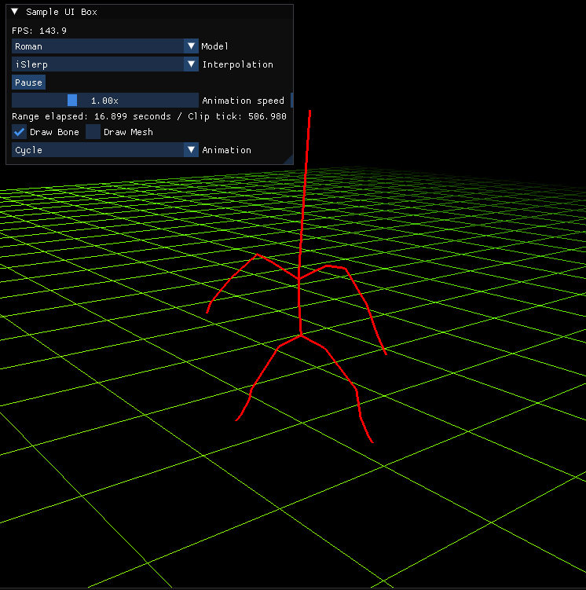
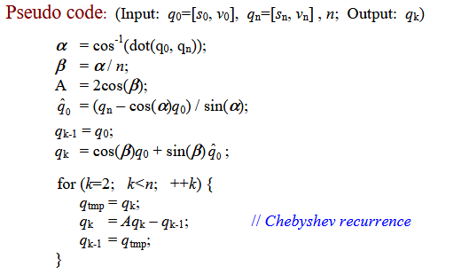
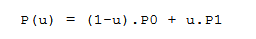
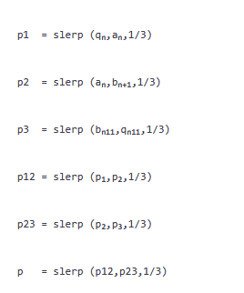
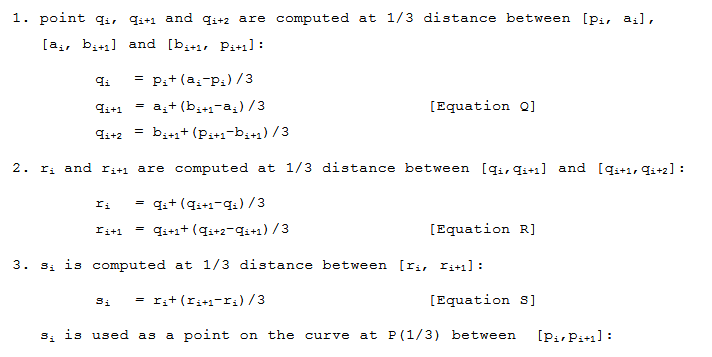
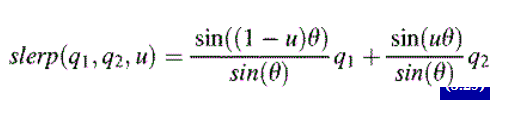
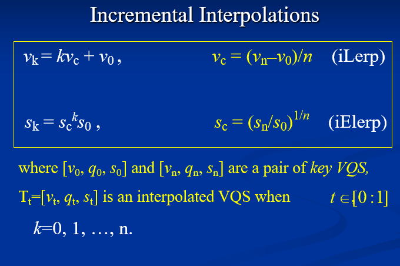
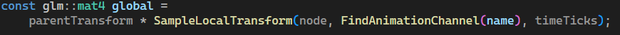

# Hierarchical Modeling and Animation

Sections:

Description

Instructions for Running Application

Interpolations Algorithms

Animating Bones and Mesh

## Instructions for Running Application:

Hold Left click to rotate around the scene to inspect different angles of the model and animations.

Hold Right click to move the camera in 8 directions around the scene

There is an IMgui interface that you can use to control various options for the scene.

Model Drop down menu: select between a Roman soldier or Viking model

Interpolation Drop down menu: select between interpolation algorithms (incremental or non incremental)

Pause or Play: Click this button to start or stop the animation of the model

Animation Speed: Click and hold this bar to control animation speed

Draw Bone and Draw Mesh check boxes: Click these to toggle skeleton and mesh draw

Animation Drop down menu: Use this to select animations

See below for a screen shot of the application and menu:

## Description:

My goal with this project is to become more familiar with some of the base algorithms responsible for animation in graphics programming. I implemented my own versions of quaternions and VQS structures, as well as some interpolation algorithms.

This document describes the algorithms used for interpolation techniques in the animation/modeling project. You can then run the project yourself if you wish to see ther results.

I’ll provide some screen shots with descriptions to show my reasoning for algorithm implementation.

## Interpolation Algorithms -

### iSlerp – Quaterion.cpp (ISlerp)

Basis for the iSlerp algorithm was lifted from the 2SlerpOrNot2Slerp document provided in the course resources.

I followed this pseudo code closely:

Our method of incrementing and interpolating a Quaternion from one to another is the Chebyshev recurrence, as well as storing calculations like the document suggests for some efficiency gains.

Our functions inputs:

start, end: map to q0 and qn ie. our quaternions

n: how many equal steps divide rotation

k: which step we want from 0 to n

state: this holds our previous calculations and data

output:

interpolated quaternion object

Function flow:

#### PrepareSlerp:

First we prepare our function using PrepareSlerp. I wrote this function since there was some duplicate code between Slerp interpolation functions. PrepareSlerp is used to normalize the quaternions to make sure we are using unit quaternions and to choose the shorter rotation path.

For the shorter path, we use the dot product of the two quaternions. If the result is negative, q1 to -q2 has a shorter path so we use the negated quaternion value instead. Source (Rick Parent, Computer Animation section 3.3)

#### Checking early exits:

We have a few if statements to check if we are close to the beginning or end of the animation clip. We also check to see if the rotations are identical, and if so, use normal linear interpolation. Here I used an equation that was outlined in the course materials:

#### Incremental Slerp:

The next block of code is very similar to the pseudo code provided by the course document. The differences are for looking up previous calculations from the animation state object and running the iSlerp calculations.

### Slerp – Quaternion.cpp

The Slerp function uses Bezier interpolation using De Casteljau method. Here, we use the same algorithm provided in Rick Parents Computer Animation section 3.3 and by the course materials “Interpolation Techniques”.

Specifically:

:

#### Bezier De Casteljau function:

Our function inputs:

q0: starting quaternion

q1, q2: control rotations

q3: ending rotation

u: value along the curve [0:1]

output: interpolated quaternion

We interpolate between adjacent inputs, then interpolate between those results, and between the final pair, all using the same Slerp function. These Slerp function calls build off each other and it’s a nice looking function because of it if I do say so myself.

#### Prepare Slerp:

We use the same function from iSlerp in this function as well since it’s the same code. As well as the early exit for when the rotations are the same (use normal linear interpolation).

#### Return:

We then use spherical interpolation equation from Computer Animation section 3.3:

The rest of our interpolation functions are in VQS.cpp. I think a cleaner approach would probably be to refactor everything into one Interpolation class, but time did not allow for that, and I am not sure if that necessarily follows SOLID programming practice.

### iLerp and iELerp – VQS.cpp (ILerp) (IELerp)

We use incremental interpolation for translation, and incremental exponential interpolation for scaler components.

Both of these functions algorithms are the same equations from the Incremental VQS Transformation power point slides found in the course material.

We have early exits similar to our Slerp functions. Then we use the same calculations as the above equation.

Input:

Start, end: position vectors vn v0

n: number of equal steps between vectors

k: the step we want from 0 to n

output:

vec3 – our interpolated position

We start at the initial position, then add movement k times in a for loop. We then return the final position.

IELerp has a very similar structure, with the same input and output except for the parameter data types and return type.

For 0 or negative endpoints, we use additive interpolation. This is because a positive geometric multiplier cannot start from zero and reach a nonzero value, so we have the fallback additive interpolation calculation.

There is an inefficiency in these functions. Unlike iSlerp, we do not store the state, therefore, we are calculating results and not storing them as they could be. At the time of writing this documentation this has not been implemented.

## Animating Bones and Mesh:

Entry point is in scene.cpp, DrawScene, through the 3 function calls EvaluatePose, UpdateSkinningPose, and UpdateSkeletonPose.

### EvaluatePose:

The EvaluatePose function clears the previous poses transforms and skeleton line points (joints). It then serves as the entry point to EvaluateNode.

EvaluateNodes main function is to traverse the hierarchy of bones (nodes) and collect end points for the bone lines as well as apply the transforms for each node. We do this by multiplying the transforms together.

The global transform includes all transforms from the root on down to the current node. We multiply the inverse root matrix by the global, therefore turning the root matrix into an identity matrix, nullifying it. This prevents an imported root translation, rotation, scale, from being stored in the node transform.

### SampleLocalTransform and SampleVQS:

Sample local transform is a wrapper that returns a local transformation matrix relative to the nodes parent, to the caller. The meat and potatoes of the animation logic is inside the function that it calls, SampleVQS.

We call FindKeySegment for every VQS component, position, rotation and scale. Afterwards, depending on which incremental mode the user has selected, we call VQS interpolate.

### FindKeySegment

This function finds the two keyframes surrounding the requested time and calculates the amount of time between the two keyframes. I decided to template this function so that it works with translation, rotation, and scale.

FindSurroundingKeys uses binary search on the sorted keys to find a pair around the time variable. We then store those indices and values. After that we calculate the values needed for interpolation n and k. Which are used in our interpolation algorithms.

### Animation

After EvaluatePose, we call UpdateSkinningPose. This updates each submeshs bone matrices for the current evaluated pose.

UpdateSkinningPose builds each submeshs palette. The palette is then uploaded to the vertex shader, and the vertex shader deforms our mesh using linear blend skinning.

UpdateSkeletonPose updates the skeleton visualization, assigning the lines used to display skeleton animation by finding the correct endpoints (joints).

## Sources:

Computer Animation by Rick Parent 3rd Edition

Interpolation Techniques – Course Material

Incremental Interpolation Techniques – Course Material

To Slerp, Or Not To Slerp – by Xin Li

Skeletal Animation With Assimp - https://ogldev.org/www/tutorial38/tutorial38.html
